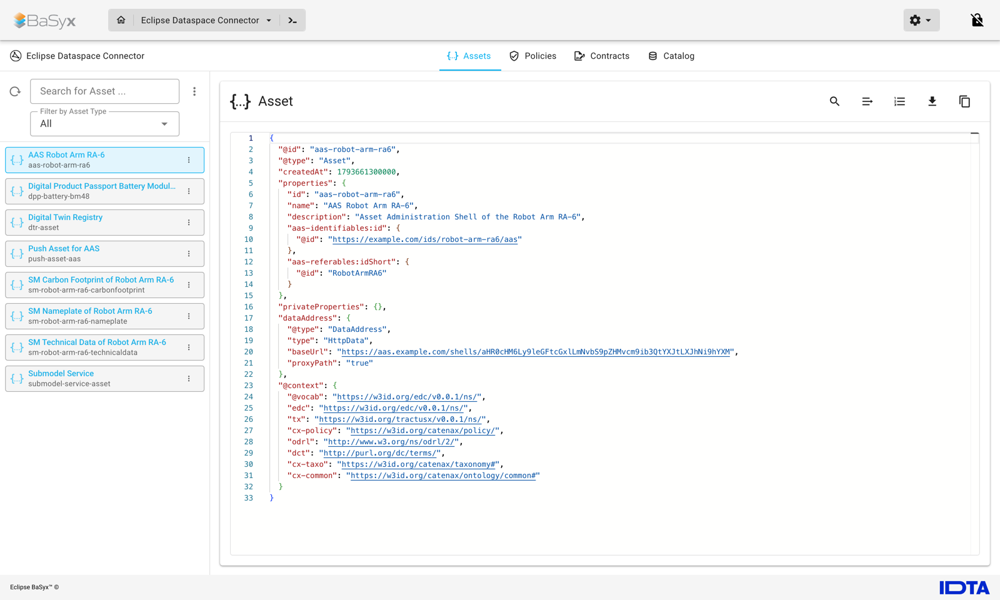
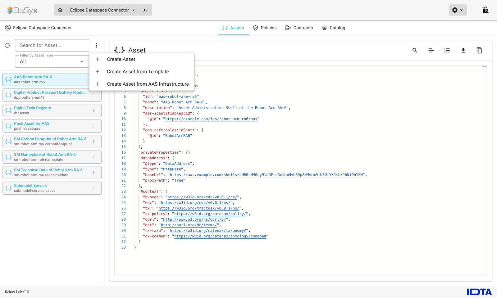
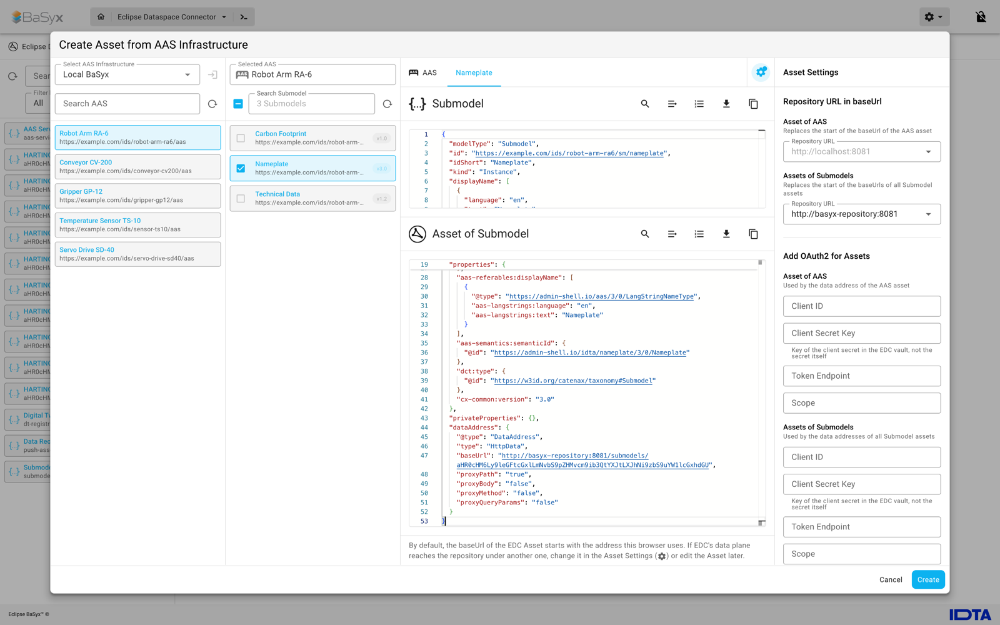
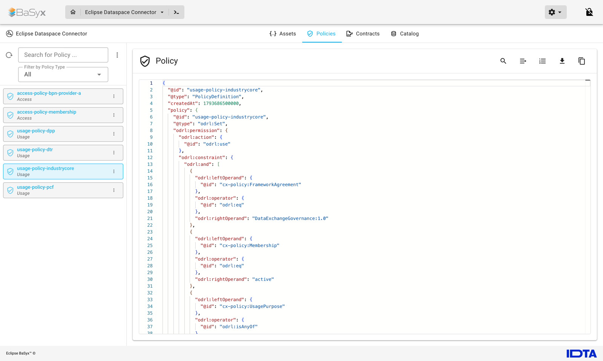
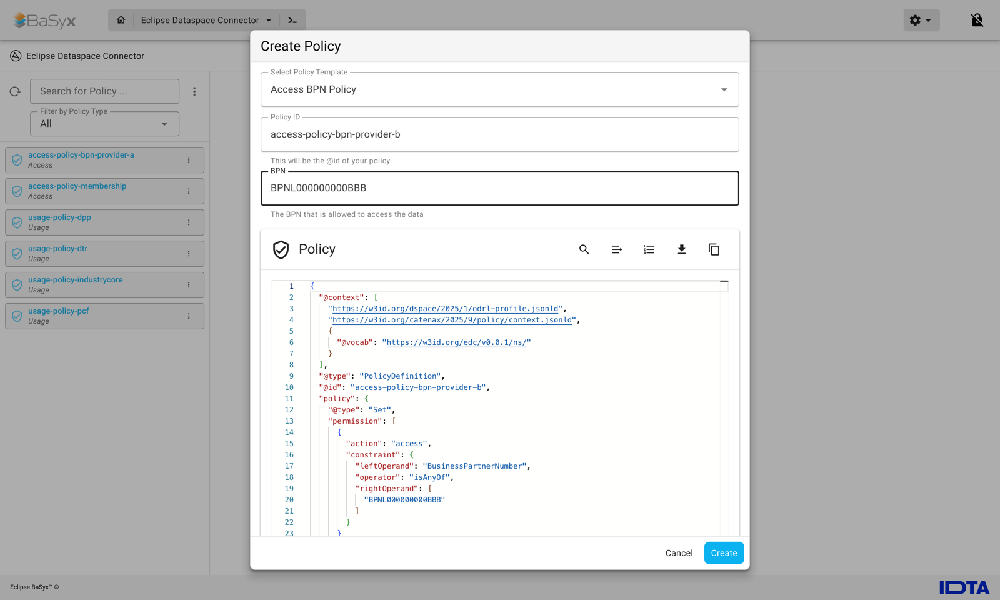
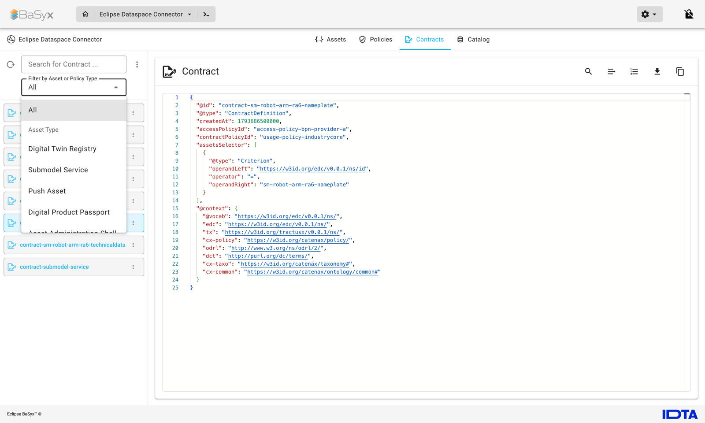
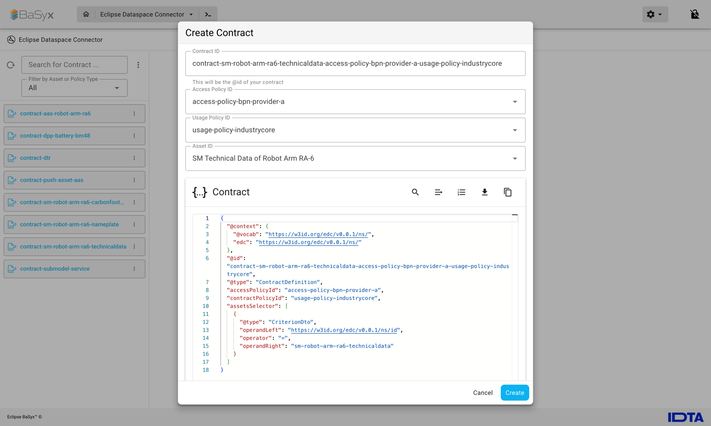
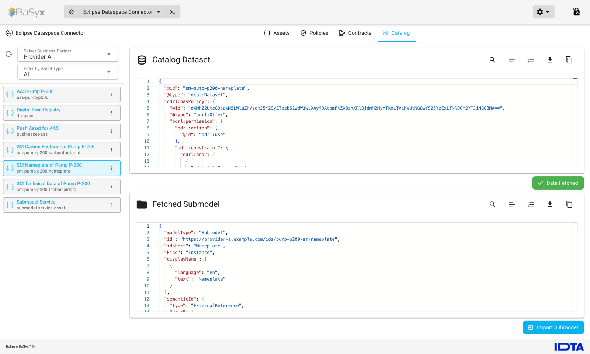
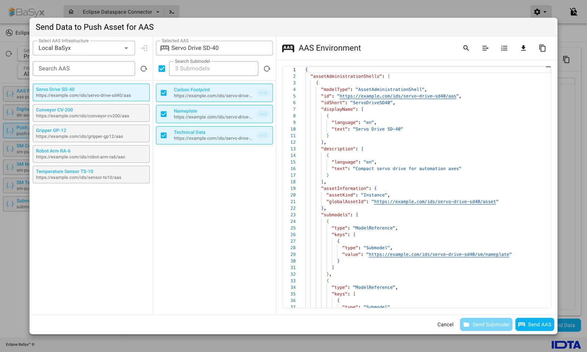

# Eclipse Dataspace Connector

> **As a** data provider or consumer in a Catena-X dataspace  
> **I want to** manage my Eclipse Dataspace Connector (EDC) and browse the catalogs of my business partners in the BaSyx AAS Web UI  
> **so that** I can offer my AAS and Submodels and fetch or send data without using the EDC Management API directly.

The **Eclipse Dataspace Connector** module manages a [Tractus-X EDC](https://github.com/eclipse-tractusx/tractusx-edc) (0.12.x and 0.13.x) from the BaSyx AAS Web UI. It provides four tabs:

| Tab | Purpose |
| --- | --- |
| **Assets** | List, create, edit and delete the assets of your EDC, also directly from an AAS and its Submodels |
| **Policies** | List, create, edit and delete access and usage policies |
| **Contracts** | List, create, edit and delete contract definitions that combine an asset with an access and a usage policy |
| **Catalog** | Browse the catalog of a business partner, fetch data from its assets, send an AAS or Submodel to it and import fetched Submodels |

The module never talks to the EDC directly. All requests go through the [Catena-X EDC BFF](../catena_x_edc_bff.md), which keeps the EDC Management API URL and API key on the server.

---

## Requirements

The module is shown in the **Modules** menu only when all of the following apply:

- The Web UI runs on a **desktop** device. The module is not available on mobile devices.
- The selected infrastructure uses the **`catena-x`** infrastructure template.
- The [Catena-X EDC BFF](../catena_x_edc_bff.md) is running and reachable under `/api/catena-x/edc/` of the Web UI, e.g. as integrated BFF with `CX_EDC_BFF_ENABLED=true`.

The module uses the EDC proxy that the selected infrastructure names in `catenaX.edc.proxyId`, or the proxy `default` if it names none. The business partners in the **Catalog** tab are the partners configured for that infrastructure. See [Infrastructure configuration](../catena_x_edc_bff.md#infrastructure-configuration).

```{important}
Creating, editing and deleting assets, policies and contracts needs **management writes** to be allowed for the EDC proxy in the BFF (`allowManagementWrites`, or `CX_EDC_DEFAULT_ALLOW_MANAGEMENT_WRITES=true` for the `default` proxy). Otherwise the module is read-only: it hides the create menu and the edit and delete actions, and only lists the resources. See [Management writes](../catena_x_edc_bff.md#management-writes).
```

```{note}
Partner connectors need to support the Dataspace Protocol (DSP) `2025-1`, i.e. Tractus-X EDC 0.11 or later. Partners that only support DSP 0.8 can't be reached. See [Supported Tractus-X EDC versions](../catena_x_edc_bff.md#supported-tractus-x-edc-versions).
```

---

## Accessing the Module

1. Select an infrastructure with the `catena-x` template.
2. Open the **Modules** menu in the navigation bar.
3. Select **Eclipse Dataspace Connector**.

The module opens with the **Assets** tab. Each tab has its own URL (`…/modules/eclipsedataspaceconnector/assets`, `…/policies`, `…/contracts`, `…/catalog`), and an open create dialog is kept in the URL as well, so the dialog is shown again after a login, for example.

---

## Working with Assets, Policies and Contracts

The **Assets**, **Policies** and **Contracts** tabs share the same layout:

- The **list** on the left shows the resources of your EDC with their name and ID. It loads further pages while scrolling.
- **Search for …** filters the list by a part of the ID, ignoring case; a **filter** below narrows it down by type.
- The reload button next to the search field loads the list again.
- Selecting a resource shows its **JSON** on the right, where it can be searched, copied and downloaded.
- The three-dot menu next to the search field opens the **create** dialogs.
- The three-dot menu of a list item offers **Edit** and **Delete**.

**Edit** opens the JSON of the resource in an editor. The ID of a resource can't be changed: an update whose `@id` differs from the ID of the resource is refused.

```{note}
IDs that contain a `/` are refused when a resource is created. The EDC can't address such a resource in a request path, so it could not be updated or deleted later.
```

### Assets



**Filter by Asset Type** narrows the list down to:

| Filter | Assets shown |
| --- | --- |
| **All** | All assets |
| **Digital Twin Registry** | Assets with the Catena-X type `cx-taxo:DigitalTwinRegistry` |
| **Submodel Service** | Assets with the Catena-X type `cx-taxo:SubmodelBundle` |
| **Push Asset** | Assets that receive data, e.g. an AAS or Submodel sent to them (ID, name or description contains `push`) |
| **Digital Product Passport** | Assets whose ID, name or description mentions `DPP` or `Digital Product Passport` |
| **Asset Administration Shell** | Assets of a single AAS |
| **Submodel** | Assets of a single Submodel |

The first three filters are sent to the EDC as a query; the others are applied in the browser to the ID, display name and description of the assets.



The create menu offers three ways to create an asset:

- **Create Asset**: fills in the default asset template. Enter at least the **Asset ID** and the **Asset Endpoint** (the `baseUrl` of the data address).
- **Create Asset from Template**: choose a template first: **Default Asset**, **Digital Twin Registry** or **Submodel Service**. The Digital Twin Registry and Submodel Service templates set the matching Catena-X asset type.
- **Create Asset from AAS Infrastructure**: creates the assets of an AAS and its Submodels in one step, see below.

The form shows a preview of the resulting asset. If the data source requires OAuth2, open the settings next to the **Asset ID** field and enter the **client ID**, the **name of the client secret in the EDC vault**, the **token endpoint** and the **scope**. The asset then refers to the secret by its name; the secret itself stays in the vault of the EDC.

#### Create Asset from AAS Infrastructure



This dialog registers an AAS and its Submodels as EDC assets:

1. Select an **infrastructure**. All configured infrastructures that provide AAS are offered, not only the selected one. For an infrastructure secured with OAuth2 you can log in from the dialog.
2. Select an **AAS**. All its Submodels are selected; deselect the ones you don't want to offer.
3. Check the preview: the upper part shows the selected AAS or Submodel, the lower part the asset created for it.
4. Select **Create**.

The module creates one asset for the AAS and one for each selected Submodel:

- The **asset ID** is the base64-encoded ID of the AAS or Submodel. A Submodel used by several AAS therefore gets a single asset.
- The `baseUrl` is the endpoint of the AAS or Submodel. Consumers can only read it and paths below it (`proxyPath` is `true`; `proxyBody`, `proxyMethod` and `proxyQueryParams` are `false`).
- The asset carries the `id`, `idShort`, `displayName`, `description`, `semanticId` and `supplementalSemanticId` of the AAS or Submodel as properties. Submodel assets are typed as `cx-taxo:Submodel` and carry the AAS specification version of their endpoint, as required by Catena-X (CX-0002).

By default the `baseUrl` starts with the address the browser uses for the repository. If the data plane of your EDC reaches the repository under another address, e.g. a service name inside a cluster, open the **Asset Settings** (gear icon next to the preview tabs) and set the **Repository URL in baseUrl**, separately for the AAS asset and for the Submodel assets. The Asset Settings also take the OAuth2 settings for both.

If the Submodels of the AAS can't be loaded, only the asset of the AAS can be created.

#### Deleting an Asset

Contracts that reference an asset are listed in the delete dialog and are **deleted together with the asset**, before it. If these contracts can't be determined, the dialog says so; the asset can still be deleted, but the contracts are kept and then reference a missing asset.

#### Secrets in Assets

The module never shows the secrets of an asset. The BFF replaces them with `<redacted>`, e.g. `authCode`, `oauth2:clientSecret`, the values of `header:*` properties and secret-like private properties such as `apiKey`, `password` or `token`. Names of vault secrets (e.g. `oauth2:clientSecretKey`) and URLs stay visible.

When you edit an asset and leave `<redacted>` in place, the BFF keeps the stored secret, as long as the rest of the data address is unchanged. If you change the `baseUrl` or any other property of the data address, enter the secret again. See [Secrets in assets](../catena_x_edc_bff.md#secrets-in-assets).

### Policies



The list shows whether a policy is an **Access** or a **Usage** policy, derived from the actions of its permissions. **Filter by Policy Type** shows only one of them.

- An **access policy** determines whether a consumer is offered an asset in the catalog at all.
- A **usage policy** determines the conditions under which a consumer can negotiate a contract for an asset.

The create menu offers:

- **Create Policy**: choose **Access Policy** or **Usage Policy** and fill in the fields of the template.
- **Create Policy from Template**: choose one of the following templates.

| Template | Purpose |
| --- | --- |
| Access Policy | Basic policy allowing usage with unrestricted access |
| Usage Policy | Policy with permissions, prohibitions and obligations |
| Usage Policy for PCF Use Case (Catena-X) | Usage policy for the Catena-X PCF use case |
| Usage Policy for PCF DPP/DBP Use Case (Catena-X) | Usage policy for the Catena-X DPP/DBP use case |
| Usage Policy for Digital Twin Registry (Catena-X) | Usage policy for a Digital Twin Registry asset |
| Usage Policy for Submodel Service (Catena-X) | Usage policy for a Submodel Service asset |
| Access BPN Policy | Access policy restricted to one Business Partner Number (BPN) |



The templates use the Catena-X policy context 2025/9 and contain the constraints Catena-X requires, e.g. `UsagePurpose` and `FrameworkAgreement`. The dialog shows a preview of the resulting policy.

### Contracts



A contract definition offers an asset to the consumers that fulfill its access policy, under the conditions of its usage policy.

**Filter by Asset or Policy Type** shows only the contracts

- whose asset matches one of the asset type filters of the **Assets** tab, or
- that use a particular **access policy** or **usage policy**.



**Create Contract** opens a dialog where you select the **Asset**, the **Access Policy** and the **Usage Policy** from the resources of your EDC. The **Contract ID** is generated as `contract-<asset ID>-<access policy ID>-<usage policy ID>` and can be changed. The dialog shows a preview of the resulting contract definition.

---

## Catalog

The **Catalog** tab shows what a business partner offers you.

1. **Select Business Partner**: choose one of the partners configured for the selected infrastructure; the default partner is preselected. The module requests the catalog of the partner through your EDC.
2. Optionally narrow the datasets down with **Filter by Asset Type** (the same filters as in the **Assets** tab).
3. Select a **Catalog Dataset** to see its JSON, including the offered policy.

Depending on the kind of dataset, the module offers an action below it.

### Fetch Data



For a dataset that provides data, **Fetch Data** negotiates a contract for the asset, waits for the Endpoint Data Reference (EDR) and fetches the data from the data plane of the partner. The fetched data is shown below the dataset. If it is an AAS or a Submodel, the title says so.

For a fetched **Submodel**, **Import Submodel** posts it to the Submodel Repository or AAS Environment of an infrastructure of your choice. Only infrastructures with one of these endpoints are offered.

Digital Twin Registries and Submodel Services give access to many AAS or Submodels and are queried through their own API, so they have no **Fetch Data** action. Use the [CatenaXplorer](catenaxplorer.md) to browse the Digital Twin Registry of a partner.

### Send Data



For a **push asset** (a dataset whose ID, name or description contains `push`), **Send Data** opens a dialog for sending an AAS or Submodel to the partner:

1. Select an **infrastructure** and an **AAS**. All its Submodels are selected; deselect the ones you don't want to send.
2. Check the preview of the **AAS Environment** to send. If a single Submodel is selected, it is shown on its own as well.
3. Select **Send AAS** to send the AAS Environment with the selected Submodels, or **Send Submodel** to send the single selected Submodel.

The module negotiates a contract for the push asset and posts the data to the data plane of the partner. Runtime fields of the Web UI, such as endpoints, are removed before sending. The data may be at most **16 MB**.

---

## Error Messages

Failed requests are shown in a message with the error of the BFF or the EDC, e.g. the validation messages of the EDC Management API. The most common errors:

| Error | Cause | Solution |
| --- | --- | --- |
| `403 EDC_MANAGEMENT_WRITES_DISABLED` | Management writes are not allowed for the EDC proxy | Allow them in the BFF, see [Management writes](../catena_x_edc_bff.md#management-writes) |
| `400 EDC_ID_NOT_ADDRESSABLE` | The ID contains a `/` | Use an ID without `/` |
| `400 EDC_REDACTED_SECRET` | `<redacted>` was left in a new asset or in a changed data address | Enter the secret again |
| `403 DATA_PLANE_ADDRESS_NOT_ALLOWED` | The data plane of the partner is not in the allowlist of the BFF | Add the origin named in the error to `CX_EDC_ALLOWED_DATA_PLANE_ADDRESSES` |
| `502 DATA_PLANE_REDIRECT_REFUSED` | The data plane of the partner answered with a redirect | Ask the partner for the final data plane address |

All error codes are listed in [Error codes](../catena_x_edc_bff.md#error-codes).
